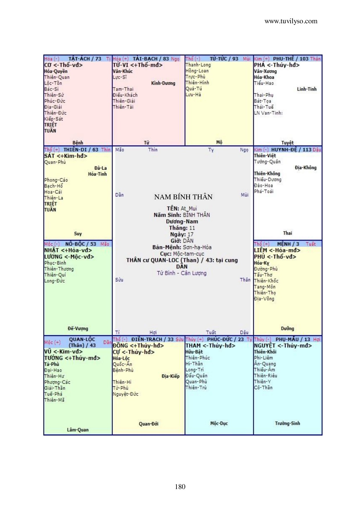

# Nam – Bính Thân

> Số Tử Vi mẫu  
> Trang sách 179–180 · *Tử Vi Thực Hành* (Dịch Lý Huyền Cơ)

Bính Thân – Tháng 11 – Ngày 17 – Giờ Dần

**Cước chú:**

Tử Phủ Vũ Tướng, giáp Khôi Việt, Thiếu Âm, Thiếu Dương  
Tử Vi của tuổi Bính Thân, cách đẹp, nhưng Thiên Phủ ngộ Tuần Triệt, không có nhiều trung tinh hội, tuy được lưỡng Giáp tốt. Nhất là tuổi này sinh vào giờ Kim xà. Cuộc sống lận đận công danh, dễ vào vòng lao lý, dù học khá có khiếu văn chương.

Cung Phối xấu, cuộc đời đơn độc, buồn thương, bất mãn. Bù lại Thiên Mã ở Quan Lộc, Hoa Cái ở Thiên Di ra ngoài được quí mến. Đại hạn 33 bộc phát và nhiều thay đổi tốt.

Đặc biệt cung Mệnh sao đều vượng theo lý giải âm dương thế là cuộc đời tốt đẹp, và phá được giờ Kim xà thiết tỏa.

### Nam Bính Thân

