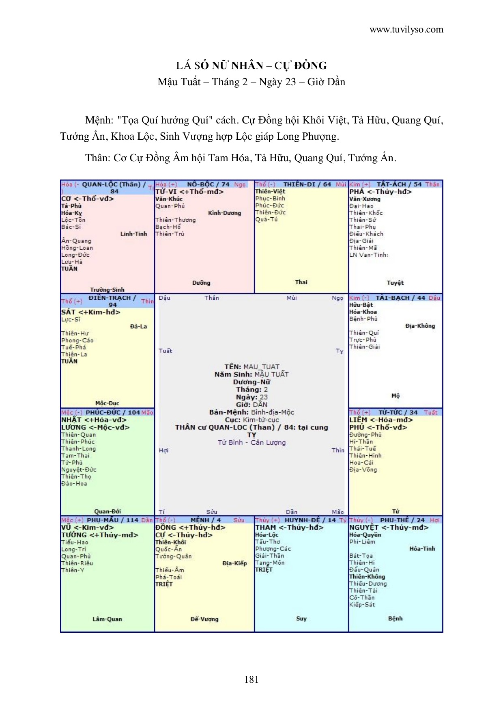

# Nữ nhân Cự Đồng – Mậu Tuất

> Số Tử Vi mẫu  
> Trang sách 181–182 · *Tử Vi Thực Hành* (Dịch Lý Huyền Cơ)

Mậu Tuất – Tháng 2 – Ngày 23 – Giờ Dần

Mệnh: "Tọa Quí hướng Quí" cách. Cự Đồng hội Khôi Việt, Tả Hữu, Quang Quí, Tướng Ấn, Khoa Lộc, Sinh Vượng hợp Lộc giáp Long Phượng.

Thân: Cơ Cự Đồng Âm hội Tam Hóa, Tả Hữu, Quang Quí, Tướng Ấn.

**Cước chú:**

Mệnh Thân đều có đa trung tinh hội, song Cự Đồng hãm địa: ở đây Đồng báo hiệu một tật bệnh ở mắt hay nội thương. Cự ở đây hãm đối với nữ mệnh tất có tướng lạ, ai trông cũng ưa, nhưng là người chua ngoa, đời tình ái dang dở, tính lẳng lơ.

Tuy xét về âm dương thì cung mệnh cục được đắc cách nên cuộc đời cũng thừa thãi. Lúc trung niên đa bất mãn hoài, nhưng đại hạn 24 tuổi có tiền của, ngoài 36 tuổi được ung dung.
