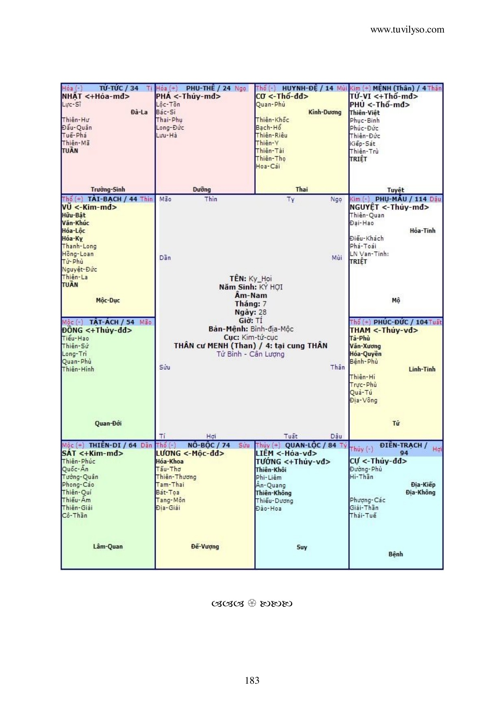

# Nam – Kỷ Hợi

> Số Tử Vi mẫu  
> Trang sách 182–183 · *Tử Vi Thực Hành* (Dịch Lý Huyền Cơ)

Kỷ Hợi – Tháng 7 – Ngày 28 – Giờ Tí

Cách:  
Tử Phủ Vũ Tướng cách hội Khôi Việt, Quang Quí, Tướng Ấn, Đào Hồng, Hóa Lộc.

Đào Hoa cư Quan. Thiên Khố thủ mệnh.

**Cước chú:**

Tử Vi của tuổi Kỷ Hợi: Mệnh Mộc an cung Thân là tuyệt địa, tuy ở đây được cách Tử Phủ, Khôi Việt, v.v… nên gọi là cách "Tuyệt xứ phùng sinh" cứu giải cho tuyệt địa, song cuộc đời tất không tránh được sự thăng trầm nhanh chóng.

Hơn nữa số này lại có Đào cư Quan, gặp Khôi Việt tất học giỏi và có tiền.

Đào Hoa cư Quan rất hay  
Giàu sang số đã sẵn tay trời dành  
Lại được Thiên Khố thủ mệnh, người sinh năm Kỷ là đắc cách:  
Hỏi ai Giáp Kỷ mấy người  
Gặp sao Thiên Khố tiền rời bạc muôn  
Tiểu hạn những năm 25, 26, 37, 39, 51 đáng lo biến cố.

