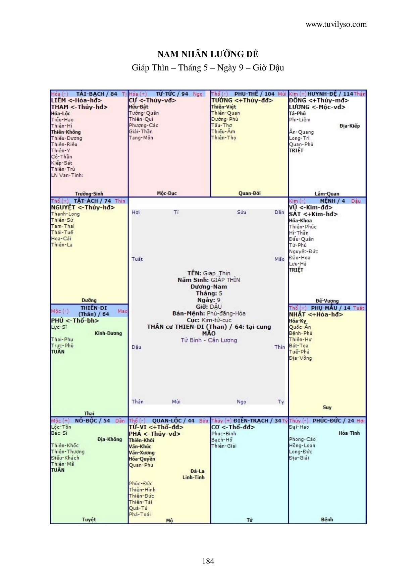

# Nam nhân Lưỡng Đế – Giáp Thìn

> Số Tử Vi mẫu  
> Trang sách 184–185 · *Tử Vi Thực Hành* (Dịch Lý Huyền Cơ)

Giáp Thìn – Tháng 5 – Ngày 9 – Giờ Dậu

Tử Vi của tuổi Giáp Thìn: Sát Phá Liêm Tham cách hội Tam Hóa, Xương Khúc, lưỡng Đế. Mệnh Cục tương khắc nhưng Cục hợp với Cung và chính tinh thành ra đắc cách.

Ở đây có lưỡng Đế hội Tam Hóa chủ về uy quyền lãnh đạo. Vũ Khúc hợp Văn Khúc tính chất anh hùng nhất là tuổi Giáp, dẫu có Đà Kình Linh Kiếp nhưng gặp Tử Vi hóa giải cả.

Tham Liêm Vũ Phá chiếu vào  
Mệnh viên có Đế dồi dao lắm thay...  
Vũ Khúc Văn Khúc rất hay  
Ở nơi đắc địa là tay anh hùng.

Thi cử tất dễ đạt, văn chương lỗi lạc, âm nhạc tinh thông, ở đây Tam Hóa đẹp vô cùng: Lộc ở Tài, Quyền ở Quan, Khoa ở Mệnh. Một lá số đẹp ít thấy. Vì gặp ác tinh được giải, gặp cát tinh đắc cách.

Đại hạn đến 34 tuổi và 44 tuổi mới thật rực rỡ
